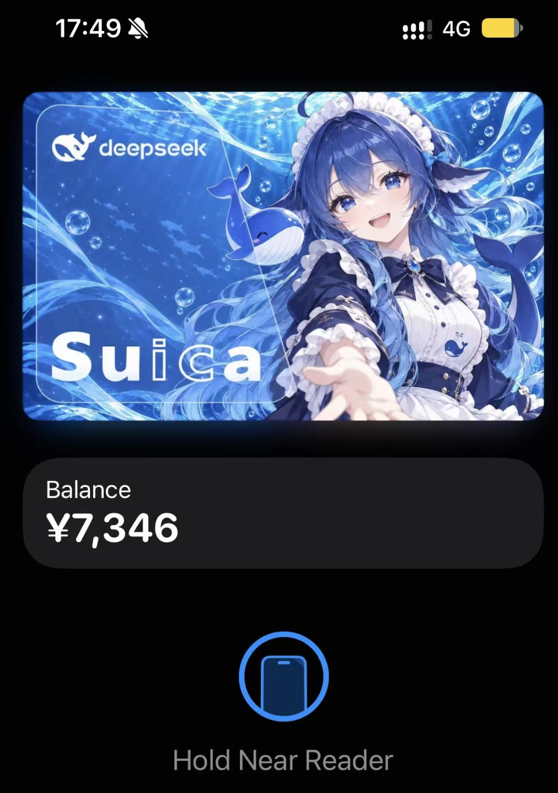
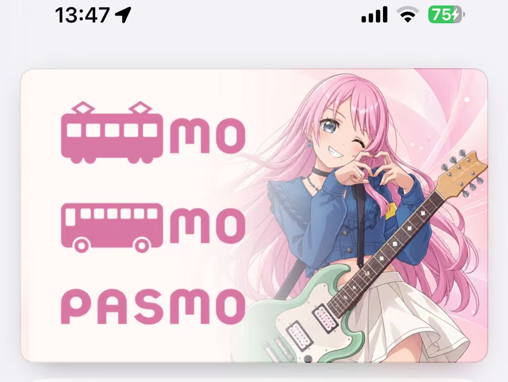

# AirCard Card Art

為 [AirCard](https://github.com/Mak5er/AirCard) 製作的 Apple Wallet 交通卡卡面，公開分享兩款最終定稿與可編輯 PSD。

Final Apple Wallet transit-card artwork for **[Mak5er/AirCard](https://github.com/Mak5er/AirCard)**, with layered PSD source files and real-device screenshots. Maintained by [Mizimo](https://github.com/Mizimo).

## 定稿預覽 / Final artwork

### Suica · DeepSeek 鯨魚娘

[PNG 卡面](artwork/suica-deepseek-whale-maid/deepseek-whale-maid-suica-layered-3c3fe760.png) · [分層 PSD](artwork/suica-deepseek-whale-maid/deepseek-whale-maid-suica-layered-3c3fe760.psd)

海底藍色主題、鯨魚女僕與小鯨魚，保留 Suica 字樣及玻璃梯形排版。PSD 將品牌、字樣、梯形描邊與填色、人物和背景分層。

### PASMO · 千早愛音 / Chihaya Anon

[PNG 卡面](artwork/pasmo-chihaya-anon/pasmo-chihaya-anon-layered-20261012.png) · [分層 PSD](artwork/pasmo-chihaya-anon/pasmo-chihaya-anon-layered-20261012.psd)

淡粉主題，保留 PASMO 的電車、巴士與字標三行排列，搭配千早愛音的眨眼比心及吉他造型。PSD 將三行品牌、人物與吉他、背景及留白漸層分層。

## 實機演示 / On-device previews

以下截圖由維護者提供，展示定稿在 Apple Wallet 的實際呈現。

<table>
  <tr><th>Suica · DeepSeek 鯨魚娘</th><th>PASMO · 千早愛音</th></tr>
  <tr>
    <td valign="top"></td>
    <td valign="top"></td>
  </tr>
</table>

## 下載與使用 / Download and use

- [下載 v1.0.0 定稿包及單獨檔案](https://github.com/Mizimo/aircard-card-art/releases/tag/v1.0.0)。
- 兩張 PNG 與兩份 PSD 均為 **1579 × 996 px**；倉庫保存維護者確認的最終檔案，沒有另外發布中間迭代。
- 使用卡面時選擇 **PNG**；要修改位置、色彩與透明度時使用 **PSD**。字標為可獨立移動的透明像素圖層。
- AirCard 的安裝、匯入圖片與套用步驟，請依照 [原項目使用說明](https://github.com/Mak5er/AirCard#how-to-customize-apple-wallet-cards) 或 [中文指南](https://github.com/Mak5er/AirCard/blob/main/docs/guides/README.zh-CN.md)。
- [SHA256SUMS](SHA256SUMS) 可用來核對下載檔案：`shasum -a 256 -c SHA256SUMS`。

Both final PNG files were checked pixel-for-pixel against the saved merged previews in their corresponding final PSDs. PNGs, PSDs, and device screenshots are stored as ordinary Git files; Git LFS is not required.

## 與 AirCard 的關聯 / Related project

此倉庫由社群維護，提供 AirCard 可使用的卡面圖片與設計原稿。

- [Mak5er/AirCard](https://github.com/Mak5er/AirCard)：Apple Wallet 卡面自訂工具。
- [AirCard 卡面素材說明](https://github.com/Mak5er/AirCard/blob/main/assets/skins/README.md)：原項目的素材與來源文件。

## 製作與授權 / Credits and license

由 **Mizimo** 整理、調整並確認最終定稿；人物與背景製作過程使用了 ImageGen 輔助。角色和品牌參考由維護者提供。

本倉庫維護者可授權的原創排版、修改與文件採用 **[CC BY 4.0](LICENSE)**。第三方商標、角色設計與參考插畫的權利仍屬於各自權利人，詳見 [NOTICE](NOTICE.md)。

Original contributions and documentation by the maintainer are shared under [Creative Commons Attribution 4.0 International](https://creativecommons.org/licenses/by/4.0/). Third-party marks, character designs, and reference artwork are excluded from that grant; see [NOTICE](NOTICE.md).
